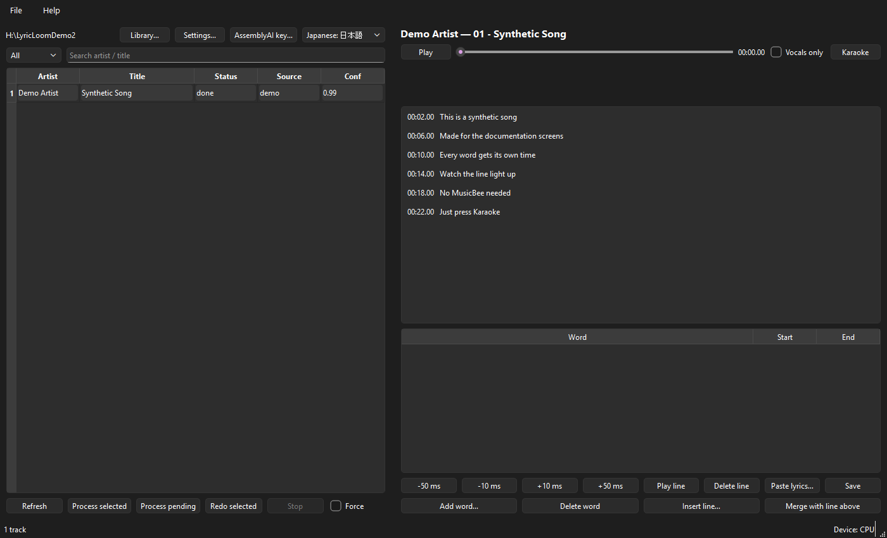
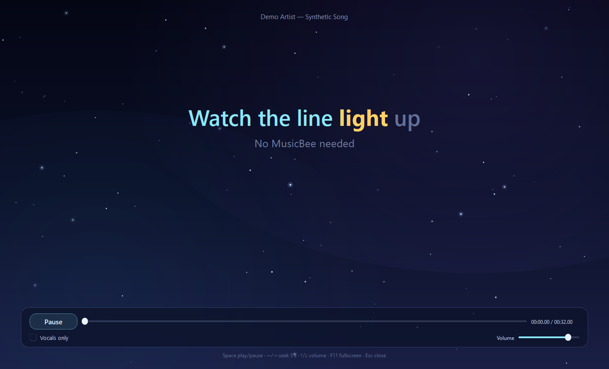

# LyricLoom and Starry Karaoke

**Word-by-word synced lyrics for the songs you already own — in the app or in MusicBee.**

This repository ships two products in one release:

- **LyricLoom** is a desktop app that finds the official lyrics of a song, aligns them against the
  isolated vocals and writes an enhanced `.lrc` file next to the audio. It has a library, a word
  editor, a compact player and a full-screen karaoke window.
- **Starry Karaoke** is an optional MusicBee plugin in `musicbee/`. It displays the same `.lrc` in a
  starry full-screen window, with word-by-word highlighting, romaji, recording and auto-open.

LyricLoom 2.2.1 and Starry Karaoke 1.3.1 are free software. The app is licensed under the **GNU GPL
v3 or later**; the plugin is **MIT-licensed**. The interface is English-only. Windows and Linux are
the supported app platforms; the plugin is for MusicBee on Windows.

[](https://github.com/nishizumi-maho/lyricloom/actions/workflows/ci.yml)
[](LICENSE)


- **Repository:** <https://github.com/nishizumi-maho/lyricloom>
- **Releases and downloads:** <https://github.com/nishizumi-maho/lyricloom/releases>

## Contents

- [What it does](#what-it-does)
- [Download](#download)
- [Quick start](#quick-start)
- [What runs where](#what-runs-where)
- [Features](#features)
- [Screenshots](#screenshots)
- [Linux](#linux)
- [Command line](#command-line)
- [Models and download sizes](#models-and-download-sizes)
- [Output format](#output-format)
- [Privacy](#privacy)
- [Documentation](#documentation)
- [Development](#development)
- [License and credits](#license-and-credits)

## What it does

LyricLoom is not a lyrics downloader that stops at line-level timing. It builds a karaoke-grade
timing track:

1. Reads the artist, title, album and duration from your audio tags.
2. Finds the official lyric on public lyrics sites. A lyric that already has word timing is also
   checked against the audio.
3. Separates the vocals from the instrumental with Mel-Band RoFormer. If the same folder has the
   song's own instrumental or off-vocal track, LyricLoom can subtract it first to give the separator
   a cleaner starting point.
4. Transcribes the isolated vocals with Whisper through whisper.cpp. The transcript is used to find
   reliable anchors and to check which lyric candidate really matches what is sung.
5. Aligns every word of the official lyric against the audio, using the LyricsAlignment-MTL singing
   model for English and MMS forced alignment for other languages.
6. Writes `<song>.lrc` in enhanced LRC format, with one timestamp per word.

The audio file is only read, never modified. The official lyric is kept as `<song>.original.lrc`,
and an existing `.lrc` is backed up before it is replaced.

The app can process one song or a whole library, mark uncertain lines for review and let you fix
timings by hand. Starry Karaoke then shows the result inside MusicBee; the built-in karaoke window
does not need MusicBee at all.

> The plugin previously lived in the separate **MusicBee-StarryKaraoke** repository. It now ships
> from this repository under [`musicbee/`](musicbee/README.md), with the same MIT license.

## Download

Download only from the official **Releases** page. The 2.2.1 release publishes:

| File | What it is |
|---|---|
| `LyricLoom-Setup-2.2.1.exe` | Windows installer, per-user, no administrator rights |
| `LyricLoom-Setup.exe` | Stable copy of the latest installer, used by the in-app updater |
| `LyricLoom-2.2.1-win64.zip` | Portable Windows build; extract and run |
| `LyricLoom-2.2.1-linux-x86_64.tar.gz` | Linux bundle with a per-user `install.sh` |
| `StarryKaraoke-MusicBee-1.3.1.zip` | MusicBee plugin release zip (also bundled with the Windows installer) |
| `SHA256SUMS` and per-file `*.sha256` | Checksums for every asset |

The Windows installer and portable ZIP include the app, its worker and `whisper-cli`. They do **not**
include the large neural models; LyricLoom downloads those only after you approve them.

## Quick start

1. **Install.** Download `LyricLoom-Setup-2.2.1.exe` and run it. The installer is per-user: it
   installs under `%LOCALAPPDATA%\Programs\LyricLoom`, needs no administrator rights and creates a
   Start-menu shortcut. The desktop shortcut is optional and unchecked. If MusicBee is installed,
   the optional **Install the Starry Karaoke plugin for MusicBee** task is offered and checked (an earlier
   choice is kept when you reinstall or update); the setup assistant can install or update it later as well. On the portable ZIP, extract it to a
   writable folder and run `LyricLoom.exe`. SmartScreen help is in
   [docs/install-windows.md](docs/install-windows.md#if-smartscreen-appears).
2. **Run the setup assistant.** The first start opens **LyricLoom setup assistant**. Choose your
   music folder, review the system check, then accept or change the suggested acceleration. CPU
   works everywhere. With an NVIDIA card, **GPU on Windows > Set up and use** downloads a CUDA
   build of PyTorch and uses it once the GPU passes a test; DirectML and a WSL GPU environment are
   optional, and the assistant can install a faster whisper.cpp build. See
   [docs/install-windows.md](docs/install-windows.md#the-setup-assistant-page-by-page).
3. **Get the models.** The assistant's **Models** page lists the suggested models (about 5 GB)
   and downloads only the ones you approve to `%LOCALAPPDATA%\LyricLoom\models`. You can skip them
   and finish later from **Help > Models…**. A model is never downloaded while a song is processing.
4. **Process a song.** Select the track (or several) in the library and click **Process selected**,
   or **Process pending** for everything without a LyricLoom `.lrc`. Watch the status column;
   `review` means at least one line is uncertain and `failed` means the error is in the row tooltip
   and the track log.
5. **Sing along.** Click **Karaoke** (**Ctrl+K**) for the built-in full-screen view, or, with
   MusicBee, use **View > Starry Karaoke**. The current line lights up word by word; the plugin can
   also open automatically for word-timed lyrics.

The full Windows walkthrough, including SmartScreen, portable mode, updates and uninstall, is in
**[docs/install-windows.md](docs/install-windows.md)**.

## What runs where

| Setup | Vocal separation | Forced alignment (MMS_FA) | English singing model (MTL) | Whisper transcription |
|---|---|---|---|---|
| **CPU only** (default everywhere) | CPU | CPU | CPU | Bundled whisper.cpp on CPU |
| **Windows + NVIDIA**, GPU on Windows (CUDA) | NVIDIA GPU | NVIDIA GPU | NVIDIA GPU | whisper.cpp cuBLAS on the NVIDIA GPU (the assistant's faster build) |
| **Windows + DirectML** (AMD, Intel or NVIDIA; experimental) | GPU for MDX-Net and VR models; RoFormer models (including the suggested one) on the GPU only with about 16 GB of video memory, else CPU | CPU | CPU | whisper.cpp on Windows (CPU, or a custom Vulkan build) |
| **Windows + WSL 2 / ROCm** (AMD GPU) | AMD GPU in WSL | AMD GPU in WSL | AMD GPU in WSL | whisper.cpp on Windows (CPU, or a custom Vulkan build) |
| **Linux + CUDA or ROCm** | GPU | GPU | CPU on native Linux | whisper.cpp as built (CPU, CUDA or Vulkan) |

- **CPU:** no extra setup beyond the models. Vocal separation is the slow stage; start with a few
  songs.
- **GPU on Windows:** the installer carries a CPU-only PyTorch, so the GPU build lives in its own
  Python environment under `%LOCALAPPDATA%\LyricLoom\runtimes`. The setup assistant builds it with
  one click: about 3 GB for **CUDA** (NVIDIA; only a current driver is needed) or about 600 MB for
  **DirectML**. It is used only after a real operation ran on the GPU, takes effect on the next
  song without a restart, and falls back to the CPU if a stage fails. DirectML speeds up vocal
  separation only: MDX-Net and VR models on any supported GPU, and RoFormer models (including
  the suggested one) with the option **Run RoFormer models on the GPU too**, which needs about
  16 GB of video memory that nothing else is using. On an RX 6900 XT the suggested model ran 3
  to 4 times faster than the CPU with identical output. Both alignment models stay on the CPU;
  WSL with ROCm remains the path that puts every stage on an AMD GPU.
- **WSL GPU:** the app stays on Windows and runs the heavy stages in WSL 2. ROCm is the AMD path;
  CUDA is available for NVIDIA. The setup assistant can use an existing environment or create one
  with the bundled script. If a WSL stage fails, LyricLoom falls back to the CPU, the status bar
  turns orange and the track log records why. See **[docs/wsl-rocm.md](docs/wsl-rocm.md)**.
- **Faster transcription:** the setup assistant can install the official whisper.cpp **BLAS**
  build (faster on any CPU) or the **cuBLAS 12.4** build (NVIDIA GPU only). Both are pinned and
  verified. A Vulkan whisper.cpp build can be used by pointing the `whisper_cli` setting or
  `LYRICLOOM_WHISPER_CLI` at it, but the project does not publish one.

## Features

### Setup, models and updates

- **Setup assistant** on first start and from **Help > Setup assistant…**: library, system check,
  acceleration, models, privacy and MusicBee, page by page.
- **Model catalog and Models window** (**Help > Models…**): several choices per stage, exact sizes
  and licenses, ready/missing/corrupt/unverified states, verified resumable downloads, verify and
  repair.
- **Per-language and per-song models**, plus custom models from a local file or an
  audio-separator registry name (trust on first use).
- **Update notice with automatic install:** checks are on by default, and **Settings > When an
  update is found** offers *Install automatically when LyricLoom closes* (default), *Ask before
  installing* or *Only notify me*. Downloads are SHA-256 verified; a silent update never closes
  MusicBee.

### Lyrics and timing

- Word-level timestamps written as enhanced LRC `<mm:ss.xx>` tags.
- Official lyrics are preferred. Whisper transcription is used as the lyric only when every public
  source fails, and that track is marked for review.
- Lyric search across LRCLIB, NetEase, QQ Music, Uta-Net, Genius and a DuckDuckGo web fallback.
  Sites that block scripted requests are skipped, not worked around.
- Ready-made word timing from a source (for example NetEase YRC) is compared with the audio; a line
  is only accepted when it agrees closely.
- Whisper anchors keep a single alignment mistake from drifting across the whole song.
- Per-line confidence and a `review` status for uncertain lines, plus **Accept line** and
  **Accept all** in the editor.
- Japanese lyrics are split with MeCab/IPADic, including inline furigana. Both
  `<song>.japanese.lrc` and `<song>.romaji.lrc` are kept; the main `.lrc` uses the script you choose.
- Songs with no official lyric can be aligned from lyrics you paste into the app, as long as the
  song has been processed once before.
- The isolated vocals can be saved for your own use as `<song>_vocal.flac`, next to each song or
  in a folder you choose (**Settings > Save isolated vocals**, off by default), and for songs
  already processed with **Save isolated vocals…** in the track's menu.

### Processing and library

- Library table with All, Review, Pending, Failed, Other, Done and **Made with other models**
  filters.
- Process selected, process pending, stop after the current track, stop now, pause after the
  current track and force reprocessing.
- Redo selected: deletes only LyricLoom's word timing and re-aligns using the cached vocals and
  transcript. **Redo with current models** is available for songs made with other models.
- Per-stage cache with model fingerprints, so changing one model or stage does not repeat the
  expensive separation and transcription work.
- Atomic writes. An existing `.lrc` becomes `.lrc.bak`, then `.lrc.bak1`, and so on.
- Batch runs continue when one track fails; the error is shown in the table and written to that
  track's log.
- **Smooth lyric animation** in the karaoke window and the main player: frame-synced word fill, a
  gliding scroll path, eased line emphasis and a slow tick while paused. **Settings > Smooth
  animation** offers *Match display* (default), *Half refresh* or *Third refresh*, always an exact
  divisor of the monitor refresh rate.
- Built-in **Karaoke** window: a full-screen starry player with word-by-word highlighting,
  previous/next line context, seek, volume and "Vocals only". Keyboard: Space, arrows, F11, Esc.
- Main-window player and word editor: play-line, nudge ±10/50 ms, add/delete/insert words and
  lines, merge, paste-and-realign, undo/redo, save.
- Optional AssemblyAI transcription for difficult tracks or Japanese songs, only when you turn on
  cloud transcription, keep a key and allow cloud use for the run.

### MusicBee

- **Starry Karaoke 1.3.1** in `musicbee/`: a starry karaoke window with word-by-word gold fill,
  Japanese/romaji modes, themes, party mode, fullscreen, per-song delay, screenshots and offline
  video recording.
- **Auto-open on by default** for word-timed lyrics; it can be limited to any synced lyrics or
  turned off. A window closed by hand stays closed for that song, and the plugin can open when
  LyricLoom writes the sidecar for the playing song.
- **Smooth lyric motion with frame-rate choices**: *Match display* (default), *Half refresh* or
  *Third refresh*. Rendering stops while the window is hidden, minimised or covered.
- **LyricLoom integration:** *Make word-timed lyrics with LyricLoom* sends the playing file with
  `--process` and reloads when the `.lrc` appears.
- **Diagnostics** with versions, paths and the log location; the plugin makes no network request.

### Platforms and hardware

- Windows installer and portable ZIP; native Linux packages/source install.
- Windows default is CPU for separation and forced alignment; whisper.cpp can use Vulkan when a
  custom build supports it.
- NVIDIA GPUs on Windows run separation, forced alignment and the English singing model on CUDA
  after the setup assistant's one-click runtime setup. DirectML is an experimental option that
  speeds up vocal separation on any vendor's GPU (RoFormer models need about 16 GB of video
  memory).
- AMD GPUs on Windows can run separation, forced alignment and the English singing model inside
  WSL 2 with ROCm. The app stays on Windows.
- Linux can use CUDA or ROCm PyTorch for separation and MMS alignment. On native Linux in 2.2.1
  the English singing model runs on the CPU.
- No telemetry, no account, and no audio upload unless you explicitly enable cloud transcription.

## Screenshots



*The main window: library status, lyric source and confidence, the preview player and the word
editor.*



*The built-in karaoke player. No MusicBee or browser is needed; the current word is highlighted as
it is sung.*

## Linux

The release tarball is the easiest path:

```bash
tar -xzf LyricLoom-2.2.1-linux-x86_64.tar.gz
cd LyricLoom-2.2.1-linux-x86_64
./install.sh
```

This installs per-user to `~/.local/opt/LyricLoom`, creates the launcher
`~/.local/bin/lyricloom` and adds a menu entry. No `sudo` is needed. The tarball bundles
`whisper-cli` but not the models. Start **LyricLoom** from the menu, or run `lyricloom`.

A source or pipx install also provides the full command line, including `lyricloom process`,
`lyricloom models ...`, `lyricloom cache ...` and `lyricloom doctor`. The packaged tarball's
`lyricloom` launcher is the windowed app, not the full CLI.

The package list, desktop entry, whisper-cli build and GPU notes are in
**[docs/install-linux.md](docs/install-linux.md)**.

## Command line

The GUI can also be started by another program:

```text
LyricLoom.exe --process "<file>" [<file> ...] [--redo]
LyricLoom.exe --open "<file>"
```

`--process` queues files (or folders) in the running window without taking focus, `--redo` redoes
their word timing, and `--open` selects a file in the library and brings the window forward. Paths
that do not exist or are not supported audio are ignored and reported. A source or pipx install
also has the engine CLI:

```bash
lyricloom process "D:\Music\Artist\Album" --no-cloud
lyricloom models list
lyricloom cache status
lyricloom doctor
```

See **[docs/command-line.md](docs/command-line.md)** for the single-instance behaviour, exit codes,
the models/cache commands, MusicBee registry values and examples.

## Models and download sizes

The release artifacts do not include the large models. **Help > Models…** (or the setup assistant)
downloads them explicitly; they are not stored in Git. Exact paths and offline instructions are in
**[docs/models.md](docs/models.md)**.

| Model | Stage | Approximate size | License | Default |
|---|---|---|---:|---|---|
| Whisper large-v3 (`ggml-large-v3.bin`) | Transcription | 2.9 GB | MIT | Yes |
| Whisper large-v3-turbo | Transcription | 1.5 GB | MIT | |
| Whisper medium | Transcription | 1.4 GB | MIT | |
| Whisper small | Transcription | 465 MB | MIT | |
| Mel-Band RoFormer vocals | Separation | 871 MB | Check the upstream model card | Yes |
| BS-RoFormer vocals (Unwa revive) | Separation | 610 MB | Check the audio-separator registry | |
| MDX-Net Voc FT | Separation | 64 MB | Check the audio-separator registry | |
| MMS_FA (torchaudio) | Alignment | 1.2 GB | **CC-BY-NC 4.0 (non-commercial)** | Yes |
| LyricsAlignment-MTL (`checkpoint_MTL`) | English singing model | 66 MB | MIT (upstream) | Yes |
| NLTK data | English singing model | 22 MB | Per NLTK data package | With MTL |

The suggested defaults total about **5 GB**. Allow extra space for the work cache and kept vocal
stems. The MMS_FA weights are non-commercial; see **[THIRD-PARTY-NOTICES.md](THIRD-PARTY-NOTICES.md)**
before commercial use.

## Output format

For `01 - Synthetic Song.flac`, LyricLoom writes `01 - Synthetic Song.lrc` next to the audio:

```lrc
[ti:Synthetic Song]
[ar:Demo Artist]
[re:LyricLoom 2.2.1]
[#source:uta-net conf:0.94]
[#engine:8]
[#models:transcribe=whisper-large-v3;separate=separator-mel-band-roformer;align=align-mms-fa]
[00:22.98]<00:22.98>This <00:23.10>is <00:23.30>a <00:23.50>synthetic <00:24.05>line<00:24.60>
[00:26.10]<00:26.10>Another <00:26.30>line<00:27.10>
```

- `[mm:ss.xx]` is the line start.
- Each `<mm:ss.xx>` is the start of the word or segment that follows it.
- A final `<mm:ss.xx>` with no text marks the end of the last segment.
- Text between tags is kept exactly as written: Japanese stays unspaced, Latin text carries its own
  spaces.
- Tags such as `[re:]`, `[#source:]`, `[#engine:]`, `[#models:]` and `[#review:]` are metadata.
  Ordinary LRC players ignore them and still show line-synced lyrics.

The full contract, including `.original.lrc`, the Japanese script variants and backup names, is in
**[docs/lrc-format.md](docs/lrc-format.md)**.

## Privacy

LyricLoom has **no telemetry, no analytics and no account system**; audio is processed locally.

1. Searching for lyrics sends the artist and title (and sometimes album/duration) to public lyrics
   providers over HTTPS.
2. Model downloads and the update check contact the hosts listed in
   **[docs/privacy.md](docs/privacy.md)** only when they run. Update checks are on by default and
   send only LyricLoom's version; they can be turned off in **Settings**.
3. Cloud transcription is off by default. Only when you turn it on, keep an AssemblyAI key and
   allow cloud use for the run does LyricLoom upload the isolated vocal stem, never the full mix.

Read **[docs/privacy.md](docs/privacy.md)** for every host, what is sent, when it happens and how to
turn it off. The short version is in **[PRIVACY.md](PRIVACY.md)**.

## Documentation

- **[docs/install-windows.md](docs/install-windows.md)** — installer, SmartScreen, setup assistant,
  GPU paths, updating and uninstall.
- **[docs/install-linux.md](docs/install-linux.md)** — tarball, source/pipx install, whisper-cli and
  GPU notes.
- **[docs/models.md](docs/models.md)** — the catalog, choices, custom models, verify/repair,
  offline install and upgrades.
- **[docs/wsl-rocm.md](docs/wsl-rocm.md)** — AMD GPUs on Windows with WSL 2 and ROCm.
- **[docs/musicbee.md](docs/musicbee.md)** and **[musicbee/README.md](musicbee/README.md)** — the
  built-in player and the Starry Karaoke plugin.
- **[docs/command-line.md](docs/command-line.md)** — GUI launch options and the engine CLI.
- **[docs/troubleshooting.md](docs/troubleshooting.md)** — common problems and diagnostics.
- **[docs/architecture.md](docs/architecture.md)** — pipeline, cache, workers and extension points.
- **[docs/lrc-format.md](docs/lrc-format.md)** — the enhanced LRC contract.
- **[docs/privacy.md](docs/privacy.md)** and **[PRIVACY.md](PRIVACY.md)** — network requests and
  local data.
- **[docs/release-notes-2.2.1.md](docs/release-notes-2.2.1.md)** — what changed in this release (and [2.2.0](docs/release-notes-2.2.0.md), [2.1.0](docs/release-notes-2.1.0.md)).
- **[CHANGELOG.md](CHANGELOG.md)** — release history.
- **[CONTRIBUTING.md](CONTRIBUTING.md)** — development setup and the monorepo layout.

## Development

Requirements: Python **3.11** (the project requires `>=3.11,<3.12`), Git, and ffmpeg for some
stages. Building or testing the MusicBee plugin also needs the **.NET 8 SDK**, which builds for
.NET Framework 4.8. GPU work is optional.

Windows:

```powershell
git clone https://github.com/nishizumi-maho/lyricloom.git
cd lyricloom
.\scripts\setup-dev.ps1
.\.venv\Scripts\python.exe -m pytest -q -p no:cacheprovider
.\.venv\Scripts\python.exe -m lyricloom doctor
```

Linux:

```bash
git clone https://github.com/nishizumi-maho/lyricloom.git
cd lyricloom
bash scripts/setup-dev.sh
. .venv/bin/activate
pytest -q -p no:cacheprovider
ruff check .
```

The Python suite runs on Windows and Linux. The MusicBee plugin has its own test project:

```powershell
dotnet test musicbee\tests\StarryKaraoke.Tests -c Release -nologo
dotnet build musicbee\src\StarryKaraoke.Recorder\StarryKaraoke.Recorder.csproj -c Release -nologo
```

Both setup scripts create a Python 3.11 environment with CPU-only PyTorch by default, which is what
the public builds use. For CUDA/ROCm development, install the GPU wheels after setup; see
[docs/install-linux.md](docs/install-linux.md#cuda-and-rocm-pytorch).

The default test run deselects tests marked `gpu`; those need real models or a GPU toolchain. See
**[CONTRIBUTING.md](CONTRIBUTING.md)** for the project layout and pull-request guidelines. The
pipeline and cache layout are documented in **[docs/architecture.md](docs/architecture.md)**.

## License and credits

LyricLoom is licensed under the **GNU General Public License, version 3 or later**. See
**[LICENSE](LICENSE)**. Starry Karaoke is MIT-licensed; see **[musicbee/LICENSE](musicbee/LICENSE)**.
Third-party components, model licenses and the non-commercial MMS_FA weights are listed in
**[THIRD-PARTY-NOTICES.md](THIRD-PARTY-NOTICES.md)**.

LyricLoom builds on the work of many open-source projects and researchers, including:

- **OpenAI Whisper** and **whisper.cpp** by Georgi Gerganov and contributors.
- **LyricsAlignment-MTL** by Jiawen Huang and contributors.
- **Mel-Band RoFormer** and **audio-separator**.
- **PySide6 / Qt**, **PyTorch**, **torchaudio**, **librosa**, **mutagen**, **pykakasi**,
  **fugashi**, **ipadic**, **soxr**, **soundfile** and the other dependencies listed in
  `pyproject.toml`.
- **MusicBee**, and the NMeCab, IPADic and RomajiCore components used by the plugin.

The project was previously called **Lyrics Boca**. LyricLoom 2.2.1 keeps reading `.lrc` files and
settings written by that name; see **[CHANGELOG.md](CHANGELOG.md)**.
